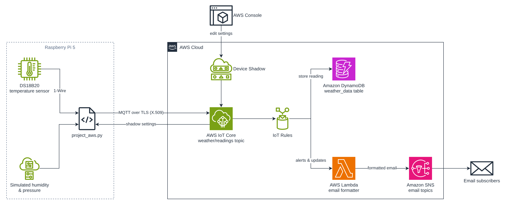

# IoT Weather Station: Raspberry Pi 5 + AWS IoT Core

This is a solo final project for ASU IFT 460, *Managing Intelligent Devices in an Enterprise Environment* (December 2025). A Raspberry Pi 5 sends weather readings to AWS IoT Core over MQTT. AWS stores them in DynamoDB, sends email updates and alerts through SNS (a Lambda function formats the update emails), and changes the device's settings remotely through Device Shadow.

> **About the data:** Temperature comes from a real DS18B20 sensor. Humidity and pressure are **simulated in Python** within plausible ranges: the DHT11 that covered humidity failed late in development, and no pressure sensor was available.

**Status:** not currently deployed.

## Architecture



1. **Device:** the Pi reads the DS18B20 over 1-Wire, converts °C to °F, adds the simulated values, and publishes JSON to `weather/readings` every 5 seconds by default (MQTT QoS 1, TLS with an X.509 device certificate).
2. **IoT Core:** the Pi is registered as the Thing `pi_weather_monitor`. Three IoT Rules act on incoming messages:
   - store every reading in the DynamoDB table `weather_data` (partition key `deviceId`, sort key `timestamp`)
   - send threshold alerts to an SNS email topic when readings fall outside set ranges
   - send every reading to an SNS demo topic through a Lambda function that formats the email
3. **Lambda:** the function turns the raw rule payload into a readable email, one metric per line, with the epoch timestamp converted to Eastern time.
4. **Device Shadow:** changes to the reading interval or the humidity/pressure on/off settings arrive as shadow delta updates and take effect without restarting the program.

Sample message:

```json
{"temperature": 77.67, "timestamp": 1765166747, "humidity": 32.74, "pressure": 1014.07}
```

## Hardware and software

- Raspberry Pi 5, Raspberry Pi OS (Trixie) on SSD, Python 3.13
- DS18B20 temperature sensor wired to GPIO through a breadboard (1-Wire)
- AWS IoT Device SDK for Python on the device; boto3 in the Lambda function
- AWS IoT Core (Rules, Device Shadow), DynamoDB, SNS, Lambda

## Testing

Each stage was tested before the next was built.

| # | What it shows |
|---|---|
| [1](docs/screenshots/01-ds18b20-sensor-test.png) | Raw DS18B20 read: CRC check passes, `t=25250` (25.25 °C) |
| [2](docs/screenshots/02-sensor-suite-output.png) | Full reading with simulated humidity and pressure, before AWS |
| [3](docs/screenshots/03-iot-core-connection.png) | Pi connects to IoT Core and publishes |
| [4](docs/screenshots/04-mqtt-test-client.png) | Message received in the IoT Core MQTT test client |
| [5](docs/screenshots/05-dynamodb-items.png) | Readings stored in DynamoDB (first three rows in °C, before the switch to °F) |
| [6](docs/screenshots/06-sns-email-raw.png), [7](docs/screenshots/07-sns-email-formatted.png) | SNS email before and after the Lambda formatter |
| [8](docs/screenshots/08-device-shadow-update.png) | Device Shadow turns humidity and pressure off remotely; later messages carry only temperature and timestamp |

## Repository contents

```
device/project_aws.py       device program that ran on the Pi
lambda/lambda_function.py   Lambda email formatter
docs/architecture.png
docs/screenshots/           test screenshots 1–8
```

## Lessons

- Source reliable components: the DHT11 failure forced a late sensor swap and simulated humidity.
- Managed AWS services (IoT Core rules, DynamoDB, SNS, Lambda) cut development time and supplied storage, alerting and remote control, so none of them had to be built from scratch.
